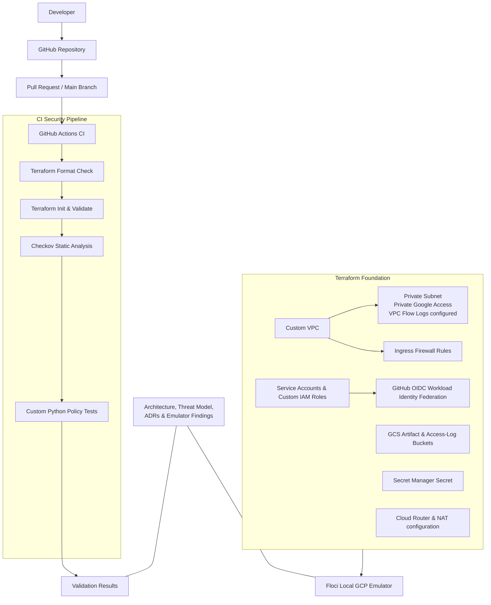
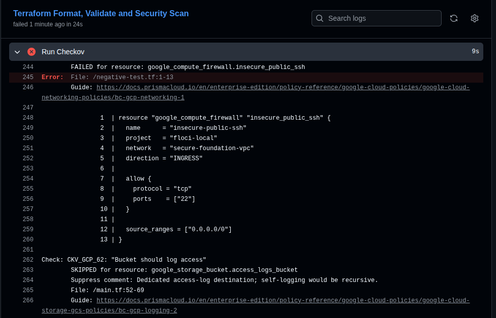
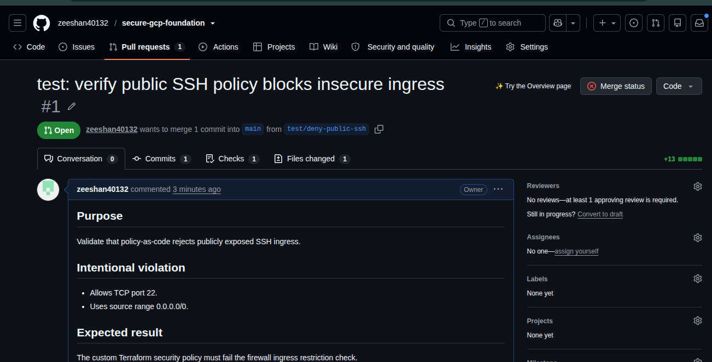
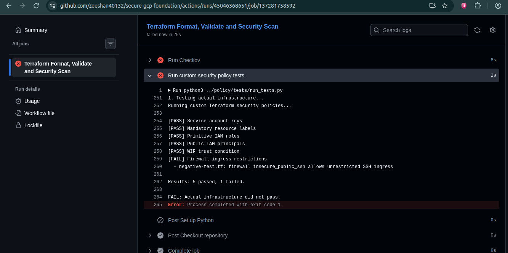
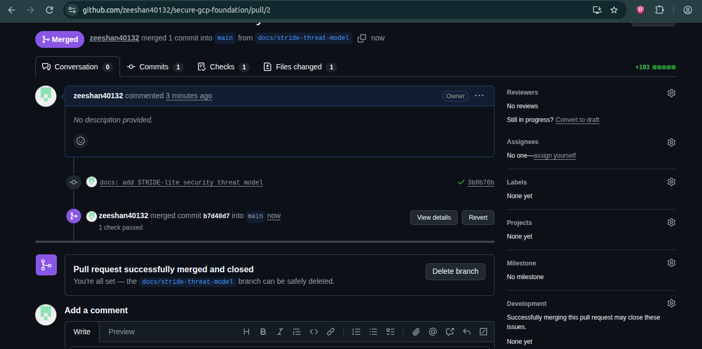

# Secure GCP Foundation with Policy-as-Code

A security-focused Google Cloud foundation defined with Terraform and validated locally using a GCP emulator, Checkov, custom Python policy checks, and GitHub Actions.

> **Project scope:** This is a local, emulator-tested portfolio project. It is not a production deployment to Google Cloud. Some resources are configured in Terraform but could not be deployed or runtime-tested because of Floci emulator API limitations. Those limitations and validation boundaries are documented below.

## Overview

This project demonstrates how to build and validate a secure cloud foundation using Infrastructure as Code and policy-as-code.

The implementation focuses on:

- Terraform-managed foundation resources.
- A custom VPC and private subnet configuration.
- Restricted ingress firewall rules.
- Least-privilege IAM role design.
- Secret Manager configuration.
- Workload Identity Federation (WIF) configuration for GitHub Actions.
- Static security analysis with Checkov.
- Custom Python policies with negative test fixtures.
- CI validation through GitHub Actions.
- Explicit documentation of emulator limitations and unverified behavior.

## Architecture



### Architecture notes

- Terraform defines the foundation resources and security configuration.
- Floci provides a local emulator for testing supported GCP APIs without a real Google Cloud account.
- GitHub Actions runs formatting, validation, Checkov, and custom policy tests.
- The Cloud Router/NAT configuration and WIF configuration are present in Terraform, but were not end-to-end deployed and verified against a real GCP environment.
- Logging, Monitoring, and Billing API probes were documented; this project does not claim that alert policies, log metrics, billing budgets, or production log ingestion were deployed.
- VPC Flow Logs are configured as infrastructure settings; actual log delivery was not verified.

## Technology Stack

| Area | Technology |
|---|---|
| Infrastructure as Code | Terraform |
| Cloud platform target | Google Cloud Platform |
| Local emulator | Floci GCP |
| Static security analysis | Checkov |
| Custom policy tests | Python |
| CI/CD | GitHub Actions |
| Version control | Git and GitHub |
| Provider | Terraform Google provider |

## Repository Structure

```text
.
├── .github/
│   └── workflows/
│       └── terraform-ci.yml
├── docs/
│   ├── decisions/
│   │   ├── 0001-terraform-for-infrastructure.md
│   │   ├── 0002-floci-local-gcp-emulator.md
│   │   ├── 0003-workload-identity-federation.md
│   │   ├── 0004-least-privilege-iam.md
│   │   └── 0005-ci-security-pipeline.md
│   ├── screenshots/
│   ├── architecture.md
│   ├── emulator-findings.md
│   ├── iam-roles.md
│   ├── security-test-results.md
│   ├── threat-model.md
│   └── troubleshooting.md
├── infra/
│   ├── backend.tf
│   ├── firewall.tf
│   ├── iam.tf
│   ├── main.tf
│   ├── nat.tf
│   ├── providers.tf
│   ├── subnet.tf
│   ├── versions.tf
│   └── wif.tf
├── policy/
│   ├── check_terraform.py
│   └── tests/
│       ├── fixtures/
│       │   └── negative/
│       └── run_tests.py
├── docker-compose.floci.yml
└── README.md
```

## Security Controls

The project includes the following controls and checks:

- **Storage security:** Uniform bucket-level access, public access prevention, object versioning, and labels on supported resources.
- **Network security:** Custom VPC, private subnet, Private Google Access configuration, and restrictive ingress firewall rules.
- **IAM:** Dedicated service accounts and custom plan/apply role design to avoid broad primitive project roles.
- **Secrets:** Secret Manager resource configuration instead of storing secrets in source control.
- **Federated CI identity:** GitHub OIDC/WIF trust configuration constrained to the intended repository and refs.
- **Policy-as-code:** Static checks for risky IAM roles, public principals, service-account keys, missing labels, weak WIF trust conditions, and unrestricted SSH/RDP ingress.

These are infrastructure definitions and static policy checks. They should not be interpreted as proof of runtime access enforcement or connectivity.

## Validation Results

The final local validation recorded for this project:

| Check | Result |
|---|---:|
| Checkov | 44 passed, 0 failed, 1 intentional skip |
| Custom policy checks against infrastructure | 6 passed, 0 failed |
| Negative security fixtures | 5 of 5 correctly rejected |
| Terraform formatting, initialization, and validation | Passed |
| GitHub Actions CI | Passed |
| Git working tree after final sync | Clean |

The intentional Checkov skip is `CKV_GCP_62` for the dedicated access-log destination bucket. Self-logging that bucket would create recursive logging behavior.

### Custom policy checks

1. Service-account key prohibition.
2. Mandatory labels for supported resource types.
3. Prohibition of primitive project IAM roles.
4. Prohibition of public IAM principals.
5. Required repository-bound WIF trust condition.
6. Restrictions on public SSH/RDP ingress.

### Negative test fixtures

The custom test runner confirmed that all five intentionally insecure examples were rejected:

- Missing mandatory labels.
- Primitive IAM role assignment.
- Public SSH ingress.
- Service-account key resource.
- WIF provider without a required subject condition.

See [`docs/security-test-results.md`](docs/security-test-results.md) for the recorded results.

## Screenshots

The repository currently contains these four screenshots:

| Screenshot | What it demonstrates |
|---|---|
| `01-public-ssh-checkov-failure.png` | Checkov detecting an insecure public SSH rule |
| `02-public-ssh-test-pull-request.png` | Security test demonstrated through a pull request |
| `03-custom-policy-rejection.png.png` | Custom policy rejection output |
| `04-threat-model-pr-ci-passed.png` | Threat-model documentation PR with CI passing |

The third filename currently has a double `.png` extension. The README references the filename exactly as it exists in the repository.

### Screenshot gallery









## Run Locally

### Prerequisites

- Linux, macOS, or Windows with WSL.
- Git.
- Docker and Docker Compose.
- Terraform.
- Python 3.
- Checkov.

### 1. Clone the repository

```bash
git clone https://github.com/zeeshan40132/secure-gcp-foundation.git
cd secure-gcp-foundation
```

### 2. Start the local GCP emulator

```bash
docker compose -f docker-compose.floci.yml up -d
docker compose -f docker-compose.floci.yml ps
```

Check the emulator health endpoint:

```bash
curl http://localhost:4588/_floci-gcp/health
```

### 3. Initialize and validate Terraform

```bash
cd infra
terraform fmt -check -recursive
terraform init -backend=false -input=false
terraform validate
```

### 4. Run Checkov

Run Checkov from the `infra` directory:

```bash
checkov -d . --framework terraform
```

### 5. Run custom policy tests

From the repository root:

```bash
cd ..
python3 policy/tests/run_tests.py
```

Use the exact Python environment and dependency setup documented in the repository if your local installation differs.

## Emulator Limitations and Verification Boundaries

Floci does not implement every Google Cloud API used by the Terraform provider. This project records API probes and deployment limitations in [`docs/emulator-findings.md`](docs/emulator-findings.md).

Important boundaries:

- The Cloud Router API returned HTTP 501 in the tested emulator environment; the Cloud Router/NAT configuration was not deployed.
- Some IAM policy operations, including the tested secret-level policy read, were unsupported by the emulator.
- WIF configuration was statically validated but not proven through a real GitHub-to-GCP federation flow.
- Logging, Monitoring, and Billing endpoints were probed and their limitations documented. No production log ingestion, alerting, monitoring metrics, or billing budget deployment is claimed.
- Firewall and subnet settings were checked as configuration; real packet filtering, IAP SSH connectivity, NAT connectivity, and telemetry delivery were not tested.
- No real GCP account, project, credentials, or billing account was used.

The emulator findings document distinguishes API/configuration checks from runtime behavior that could not be verified.

## Documentation

- [System Architecture](docs/architecture.md)
- [Threat Model](docs/threat-model.md)
- [IAM Roles](docs/iam-roles.md)
- [Security Test Results](docs/security-test-results.md)
- [Emulator Findings and Limitations](docs/emulator-findings.md)
- [Troubleshooting](docs/troubleshooting.md)
- [Architecture Decision Records](docs/decisions/)

## What I Learned

- Structuring a cloud foundation using Terraform.
- Applying least-privilege IAM design.
- Building network security controls through infrastructure code.
- Using Checkov and custom Python policy-as-code checks.
- Testing security controls with intentionally negative fixtures.
- Integrating infrastructure validation into GitHub Actions.
- Documenting cloud emulator limitations and separating static validation from runtime verification.

## Repository

[github.com/zeeshan40132/secure-gcp-foundation](https://github.com/zeeshan40132/secure-gcp-foundation)
