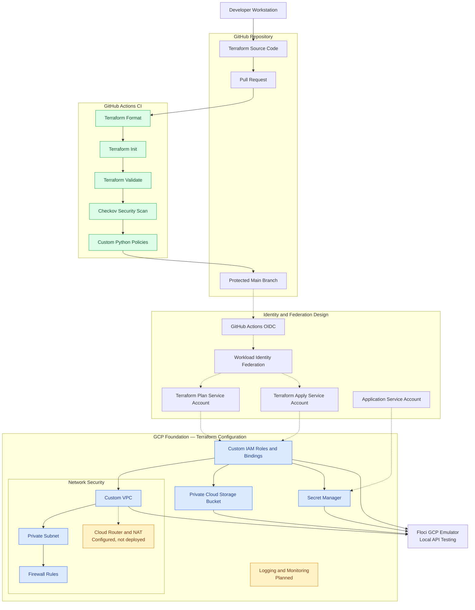

# Secure GCP Foundation — System Architecture

## 1. Overview

This project implements a security-focused Google Cloud foundation using Terraform and policy-as-code.

The architecture follows a defense-in-depth approach, combining infrastructure as code, least-privilege IAM, private networking, static security analysis, and GitHub Actions CI.

A local Floci GCP emulator is used to test supported infrastructure APIs without requiring a real Google Cloud account.

## 2. High-Level Architecture

**Diagram legend:**
- Solid connections represent the logical flow or relationship.
- Dashed connections represent configured identity relationships or planned integrations.
- Blue components represent infrastructure defined in Terraform.
- Green components represent CI validation stages.
- Amber components represent planned or unverified functionality.

## 3. CI/CD Security Pipeline

Every pull request targeting `main` triggers the GitHub Actions workflow.

The pipeline performs:

1. Terraform formatting validation.
2. Terraform initialization without a remote backend.
3. Terraform configuration validation.
4. Checkov security scanning.
5. Custom Python policy tests.

The required CI status check must succeed before a pull request can be merged.

The public SSH negative-test pull request demonstrated that both Checkov and the custom policy checker reject unrestricted SSH ingress.

## 4. Identity Architecture

Three service accounts have distinct responsibilities:

| Identity | Responsibility |
|---|---|
| `sa-tf-plan` | Read-only infrastructure inspection |
| `sa-tf-apply` | Scoped infrastructure management |
| `secure-foundation-app` | Application runtime identity |

GitHub Actions OIDC is configured to establish trust through Workload Identity Federation.

The provider condition restricts the trusted repository and permits pull-request and main-branch subjects.

The apply service account has an additional main-branch condition.

**Implementation status:** Terraform configuration and static policy checks are complete. Real GCP federation and token exchange have not been tested.

## 5. Network Architecture

The network configuration includes:

- Custom VPC with automatic subnet creation disabled.
- Private subnet using `10.10.0.0/24`.
- Private Google Access enabled.
- VPC Flow Logs configuration.
- Default deny-all ingress firewall rule.
- IAP-only SSH access from `35.235.240.0/20`.
- Internal TCP, UDP, and ICMP communication within the private subnet.

Cloud Router and Cloud NAT resources are defined in Terraform but were not deployed because the Floci emulator does not implement the required router API.

## 6. Storage and Secrets

### Cloud Storage

The foundation includes:

- Uniform bucket-level access.
- Public access prevention.
- Object versioning.
- Dedicated access-log destination bucket.
- Mandatory labels.

### Secret Manager

A dedicated application secret container is configured.

The application service account receives the `roles/secretmanager.secretAccessor` role at the individual secret level rather than project-wide scope.

No real secret values are included in the repository.

## 7. Emulator and Deployment Boundary

Floci GCP is used as a local API emulator.

Terraform resources supported by the emulator were created and inspected through API responses and Terraform state.

Some capabilities remain unverified:

- Cloud Router and Cloud NAT deployment.
- Runtime IAM authorization enforcement.
- Secret-level IAM policy retrieval.
- Real GitHub OIDC token exchange.
- Production audit logging and billing alerts.

No real GCP project was deployed or used.

## 8. Security Design Principles

The architecture follows these principles:

1. Least privilege for service identities.
2. Private-by-default network access.
3. No long-lived service account keys.
4. Infrastructure changes through reviewed pull requests.
5. Automated policy enforcement in CI.
6. Separation of plan, apply, and application identities.
7. Explicit documentation of emulator limitations.

## 9. Future Improvements

The following enhancements can be implemented in a real GCP environment:

- Organization Policy constraints.
- VPC Service Controls.
- Security Command Center.
- Binary Authorization.
- Cloud Monitoring alert notifications.
- Real billing budgets and spend notifications.
- End-to-end Workload Identity Federation validation.
- Cloud NAT connectivity testing.
